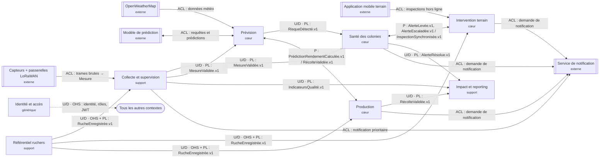

# Context map : QueenBee

## 1. Objectif

Cette context map montre les relations entre les **8 bounded contexts** de QueenBee (voir `bounded-contexts.md`) et les systèmes externes : qui publie quoi, qui dépend de qui, avec quel type de relation. Chaque flèche porte un type de relation et ce qui est échangé.

Les types de relation sont des choix d'architecture proposés. Ceux qui dépendent d'une décision encore ouverte sont signalés dans la section 6.

## 2. Les contextes

| Contexte | Type | Responsabilité |
|---|---|---|
| Référentiel ruchers | support | Sites, ruches, capteurs, passerelles et leurs associations |
| Identité et accès | générique | Comptes, rôles, permissions, authentification |
| Collecte et supervision | support | Réception, validation et publication des mesures ; incidents d'infrastructure |
| Prévision | cœur | Prédictions de risque et de rendement |
| Santé des colonies | cœur | Cycle de vie des alertes de colonie |
| Intervention terrain | cœur | Visites, inspections, synchronisation hors ligne |
| Production | cœur | Récoltes et écarts de rendement |
| Impact et reporting | support | Indicateurs multi-sites et rapports aux bailleurs |

## 3. Carte

**Légende :** U/D = Upstream/Downstream (amont → aval) · OHS = Open Host Service · PL = Published Language (événement versionné) · P = Partnership · ACL = couche anticorruption · rectangle à double bord = système externe · flèche en pointillé = relation vers tous les contextes.

## 4. Détail des relations

| Amont | Aval | Relation | Échange | Justification |
|---|---|---|---|---|
| Capteurs + passerelles | Collecte et supervision | ACL | Trames brutes (hive_id, mesures, timestamp) | Le format LoRaWAN et les trames bruitées ne doivent pas entrer dans le modèle : l'ACL les traduit en `Mesure` |
| OpenWeatherMap | Prévision | ACL | Données météo | Format et disponibilité imposés par un tiers |
| Modèle de prédiction | Prévision | ACL | Requêtes et prédictions | Le modèle ML évolue indépendamment ; Prévision isole son format |
| Application mobile | Intervention terrain | ACL | Inspections enregistrées hors ligne | Le format hors ligne diffère du modèle d'inspection central |
| Référentiel ruchers | Collecte, Terrain, Production | U/D · OHS + PL | `RucheEnregistrée.v1` | Trois consommateurs : une ruche inconnue doit être rejetée (Collecte), visitée (Terrain), récoltée (Production) |
| Collecte et supervision | Santé des colonies | U/D · PL | `MesureValidée.v1` | Seule une mesure validée alimente le score et les risques |
| Collecte et supervision | Prévision | U/D · PL | `MesureValidée.v1` | Les modèles se nourrissent des mêmes mesures validées |
| Collecte et supervision | Impact et reporting | U/D · PL | `IndicateursQualité.v1` | Qualité de collecte pour les rapports, sans exposer les mesures brutes |
| Prévision | Santé des colonies | U/D · PL | `RisqueDétecté.v1` | Un risque détecté déclenche la levée d'une alerte |
| Prévision | Production | Partnership | `PrédictionRendementCalculée.v1` et `RécolteValidée.v1` | Boucle de rétroaction : la prédiction sert à comparer la récolte, la récolte validée sert à recalibrer ; les deux équipes livrent ensemble |
| Santé des colonies | Intervention terrain | Partnership | `AlerteLevée.v1`, `AlerteEscaladée.v1`, et en retour `InspectionSynchronisée.v1` | Alerte → inspection → résolution : cycle commun, évolutions coordonnées |
| Production | Impact et reporting | U/D · PL | `RécolteValidée.v1` | Volumes validés pour les indicateurs |
| Santé des colonies | Impact et reporting | U/D · PL | `AlerteRésolue.v1` | Nombre de colonies à risque et délais de résolution |
| Identité et accès | Tous les autres | U/D · OHS | Identité, rôles, permissions par site (JWT) | Service ouvert, même contrat pour tous les consommateurs |
| Santé, Terrain, Production, Collecte | Service de notification | ACL | Demande d'envoi (push, SMS, e-mail) | Canaux externes ; la notification n'est pas l'alerte |

## 5. Principes

- **Une alerte n'est pas un incident.** « Alerte » reste dans Santé des colonies ; les pannes d'infrastructure sont des incidents dans Collecte et supervision. Cette frontière est la plus importante de la carte.
- **Seule la mesure validée traverse la frontière.** Collecte et supervision est propriétaire du contrat `MesureValidée.v1`, que Santé, Prévision et (en indicateurs) Impact utilisent sans le redéfinir.
- **Tout système externe passe par une ACL** : capteurs, météo, modèle, application mobile, notifications.
- **Les événements sont versionnés** (`.v1`). Un changement incompatible crée une `.v2` avec une période de double publication (voir ADR-003).
- **Les frontières de confiance** (authentification à chaque passage) sont traitées dans le livrable Cyber, pas ici.

## 6. Points à confirmer

1. Qui orchestre les notifications : chaque contexte (comme dessiné) ou un service dédié ?
2. Reporting consomme-t-il des événements bruts ou uniquement des indicateurs préagrégés ?
3. Le modèle de prédiction est-il externe à la plateforme (ACL) ou interne à Prévision ?
4. Qui est propriétaire des associations ruche–capteur–passerelle : Référentiel seul, ou Collecte aussi ?